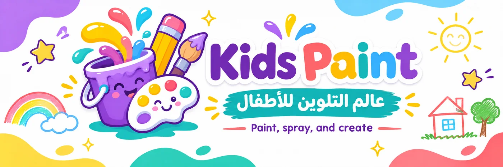
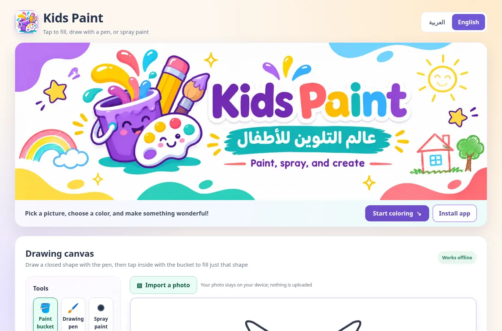
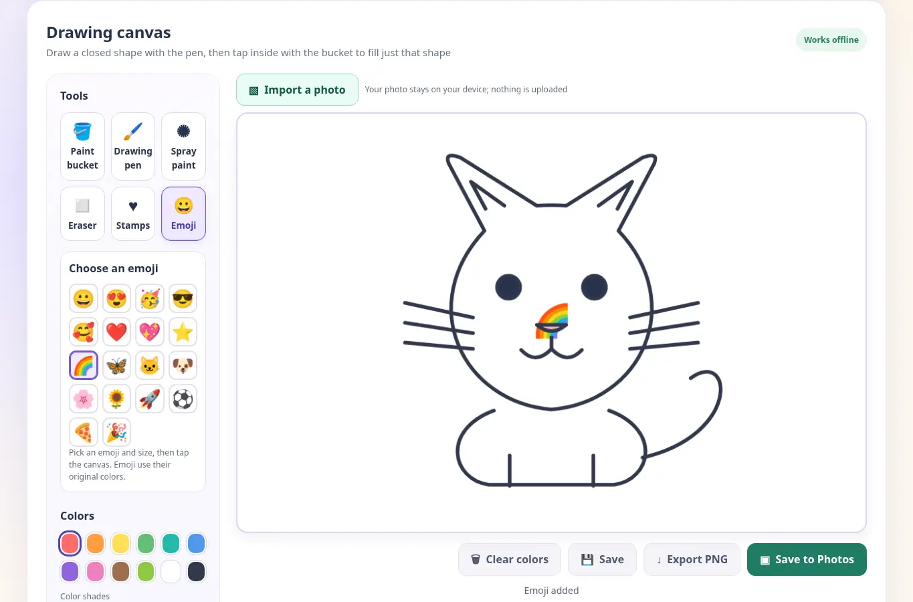
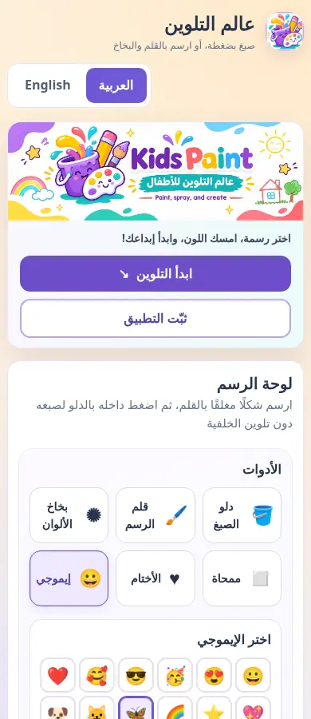

# عالم التلوين للأطفال — Kids Paint

**[العربية — النسخة الحالية](README.ar.md) · [English — النسخة الأساسية](README.md)**

[](LICENSE)


[](https://abinadwan.github.io/kids-paint/)



**Kids Paint** منصة تلوين ورسم مجانية ومفتوحة المصدر للأطفال، تدعم العربية والإنجليزية، وتعمل على الجوال والكمبيوتر. يمكن استيراد صورة من الاستديو والرسم فوقها، وإضافة أختام وإيموجي، وحفظ المشاريع على الجهاز أو تصديرها بصيغة PNG. ويمكن تثبيت الموقع كتطبيق على الشاشة الرئيسية واستخدام أدوات الرسم دون اتصال بعد اكتمال تحميل ملفات التطبيق أول مرة.

**رابط المنصة:** https://abinadwan.github.io/kids-paint/

## صور الشاشة

لقطات حقيقية للواجهة التُقطت باستخدام متصفح Chromium؛ ليست لقطات من جهاز آيفون فعلي.

| نسخة الكمبيوتر | لوحة الإيموجي والرسم |
| --- | --- |
|  |  |

**واجهة الجوال بالعربية:**



## الجديد في الإصدار v4.2

- **أداة الإيموجي:** أضفنا 18 رمزًا تعبيريًا تشمل الوجوه والقلوب والنجوم وقوس قزح والفراشة والحيوانات والزهور والصاروخ والكرة وغيرها. اختر الإيموجي، واضبط حجمه، واضغط على اللوحة أو الصورة لإضافته. يدعم التراجع والإعادة والمسح والحفظ وتصدير PNG. **ألوان الإيموجي أصلية من نظام الجهاز**، ولا تتغير بلوحة الألوان، بعكس الأختام المتجهة.
- **حفظ في الصور:** أضفنا زرًا يحضّر الصورة بصيغة PNG ويفتح **قائمة المشاركة** إذا كان الجهاز والمتصفح يدعمان مشاركة الملفات. على الآيفون اختر **«حفظ الصورة / Save Image»** من القائمة لإضافتها إلى تطبيق الصور. لا يمكن للموقع إضافتها إلى الاستديو تلقائيًا دون اختيار المستخدم. إن لم تتوفر المشاركة ينزّل التطبيق PNG، ويمكن فتح الملف ثم حفظه يدويًا في الصور.
- **توثيق كامل:** النسخة الإنجليزية أصبحت أساسية في `README.md` مع نسخة عربية منفصلة في `README.ar.md` ولقطات للشاشة.
- **تحديث ملفات PWA:** التخزين المؤقت للإصدار `v4.2.0` حتى يحصل التطبيق المثبت على تحديث الواجهة والأدوات عند عودة الإنترنت.

## الأدوات والمزايا

| الميزة | الوظيفة |
| --- | --- |
| قلم الرسم | الرسم بحرية مع تحديد حجم القلم، ويمكن صبغ الأشكال المغلقة التي يرسمها المستخدم |
| بخاخ الألوان | توزيع نقاط ألوان متناثرة عند الضغط أو السحب |
| دلو الصبغ | صبغ مناطق الرسومات الجاهزة والأشكال اليدوية المغلقة؛ لا يغطي الصور المستوردة بالكامل |
| الممحاة | إزالة الرسم والألوان والأختام والإيموجي دون حذف الصورة الأصلية أو حدود الرسومات الجاهزة |
| الأختام | 6 أشكال قابلة لتغيير اللون والحجم: قلب، نجمة، فراشة، زهرة، هلال، وجه مبتسم |
| الإيموجي | 18 رمزًا بألوان النظام الأصلية، مع تغيير الحجم والوضع بالنقر |
| لوحة الألوان | 12 لونًا أساسيًا، لكل لون 5 درجات، بالإضافة إلى لون مخصص |
| استيراد الصور | استيراد صور يدعمها المتصفح مثل JPG وPNG وWebP من الاستديو أو الملفات (بحد أقصى 30 ميغابايت) |
| الرسومات الجاهزة | 13 رسمة متجهة مع صفحة رسم حر، بإجمالي 14 خيارًا |
| التراجع والإعادة | الرجوع والتقدم ضمن سجل يصل إلى 22 حالة رسم |
| حفظ / فتح / حذف | مشاريع قابلة للتعديل، محفوظة محليًا عبر IndexedDB مع بديل localStorage |
| تنزيل PNG | حفظ صورة نهائية مسطحة بمقاس 960 × 640 بكسل |
| حفظ في الصور | إرسال PNG إلى قائمة مشاركة الجهاز أو تنزيله بديلًا عن ذلك |
| اللغات | العربية والإنجليزية مع تغيير اتجاه العرض RTL/LTR |
| تطبيق PWA | قابل للتثبيت على الشاشة الرئيسية ويعمل دون إنترنت بعد تنزيل ملفات التشغيل |

## طريقة الاستخدام

افتح [الموقع](https://abinadwan.github.io/kids-paint/)، واختر رسمة جاهزة أو «رسم حر»، ثم اختر الأداة واللون وحجمها. يمكن الانتقال بين درجات اللون أو استخدام «لون مخصص». **الإيموجي يحتفظ بلونه المعتاد في الجهاز**، بينما تستخدم الأختام لونك المختار.

لإضافة صورة، اضغط **«استيراد صورة من الاستديو»** واختر صورة من الجهاز. تظهر الصورة في طبقة خلفية مستقلة ويمكن الرسم والبخاخ والأختام والإيموجي فوقها. يتناسب حجم الصورة مع مساحة 960 × 640 دون قصّ أو تشويه، وقد تظهر حواف بيضاء حسب أبعاد الصورة. الصور التي تتجاوز 30 ميغابايت تُرفض، ودعم HEIC/HEIF يعتمد على المتصفح.

**تنبيه دلو الصبغ:** فوق صورة مستوردة لا يسمح الدلو بصبغ الصورة كلها؛ ارسم بالقلم شكلًا مغلقًا ثم اضغط بداخله. أما الرسومات الجاهزة أو صفحة الرسم الحر، فقد يصبغ الضغط خارج الشكل المغلق الخلفية المحيطة. البخاخ والإيموجي ليسا مخصصين لتشكيل حدود تعبئة.

## تثبيت التطبيق على الجوال والعمل دون إنترنت

**الآيفون (Safari):** انتقل إلى **زر «ثبّت التطبيق» أسفل صفحة عالم التلوين**. تظهر تعليمات مختصرة **من أسفل الشاشة** مخصصة للآيفون فقط. لا يستطيع الموقع تثبيت نفسه تلقائيًا بسبب قيود iOS؛ اختر من Safari **قائمة الصفحة ← مشاركة ← إضافة إلى الشاشة الرئيسية ← فتح كتطبيق ← إضافة**. افتح التطبيق مرة وأنت متصل بالإنترنت. قد يكون تخزين التطبيق المثبت منفصلًا عن Safari، لذلك صدّر رسوماتك المهمة قبل حذف بيانات المتصفح.

**أندرويد (Chrome):** انتقل إلى **زر «ثبّت التطبيق» أسفل الصفحة** واضغطه. إذا أتاح Chrome التثبيت المباشر، تظهر نافذة التثبيت الرسمية فورًا للموافقة عليها؛ وإلا تظهر تعليمات مختصرة من الأسفل لاستخدام **⋮ ← تثبيت التطبيق / إضافة إلى الشاشة الرئيسية**. يختفي زر التثبيت داخل التطبيق المثبّت. افتحه أول مرة أثناء الاتصال.

يحفظ **Service Worker** صفحات التشغيل وCSS وJavaScript والبنر والأيقونات محليًا ضمن مسار `/kids-paint/`. بعد نجاح التحميل الأول يمكن فتح أدوات التلوين دون شبكة. **الرسومات المحفوظة في تخزين المتصفح، وليست مرفوعة على GitHub ولا محفوظة داخل Service Worker**. قد يحذف النظام أو المتصفح هذا التخزين لاحقًا، لذلك احتفظ بنسخة PNG من الأعمال المهمة.

## الفرق بين الحفظ وتنزيل الصورة وحفظها في الاستديو

- **«حفظ»:** الاحتفاظ بمشروع قابل للتعديل داخل التطبيق الحالي على الجهاز؛ لا توجد مزامنة سحابية. قد تُضغط الصورة المستوردة وتُصغّر لحفظ المساحة.
- **«تنزيل PNG»:** حفظ الصورة النهائية في «التنزيلات» أو «الملفات» بحسب الجهاز والمتصفح، وليست بالضرورة داخل الاستديو.
- **«حفظ في الصور»:** فتح قائمة المشاركة واختيار **«حفظ الصورة»** يدويًا على الآيفون عند توفرها؛ أو تنزيل PNG ثم فتحه واختيار حفظه في الصور. **لا يوجد حفظ تلقائي مضمون إلى ألبوم الصور من موقع ويب.**

## الخصوصية والقيود

- التطبيق يعمل محليًا بلا حسابات أو إعلانات أو تحليلات أو خادم لاستقبال الصور. استيراد الصور والرسم لا يرسلان الملفات إلى الإنترنت؛ مشاركة الصورة إلى تطبيق خارجي تتم فقط إذا اختار المستخدم ذلك.
- يعتمد ظهور الإيموجي على خط ونظام الجهاز وقد تختلف الرسومات بين iOS وأندرويد والكمبيوتر.
- الحفظ يفضّل IndexedDB مع بديل localStorage الأقل سعة. قد يختلف التخزين بين Safari والتطبيق المثبت، وقد تفقد الرسومات عند حذف بيانات الموقع أو نقص المساحة.
- اللوحة ثابتة بمقاس 960 × 640، والصور تُناسب داخلها. يجب أن تكون حدود الشكل اليدوي مغلقة ليعمل الدلو بدقة.
- تتوفر تسميات للأزرار ودعم العربية والإنجليزية وأحجام لمس مناسبة، لكن الرسم نفسه يعتمد أساسًا على اللمس أو الماوس.
- جرى اختبار الوظائف آليًا في Chromium؛ **يلزم اختبار نافذة المشاركة وحفظ الصورة فعليًا على آيفون وأندرويد**.

## ملفات المشروع

| الملف | وظيفته |
| --- | --- |
| `index.html` | واجهة البرنامج والأدوات واستيراد الصور والحفظ |
| `style.css` | تنسيق الكمبيوتر والجوال ولوحة الأختام والإيموجي |
| `drawing.js` | الرسم والصبغ والإيموجي والمشاركة والحفظ والترجمة |
| `pwa.js` | شرح تثبيت التطبيق |
| `sw.js` | تخزين ملفات التشغيل للعمل دون إنترنت |
| `manifest.webmanifest` | تعريف التطبيق وأيقوناته |
| `assets/` | البنر والأيقونات الرسمية |
| `docs/screenshots/` | لقطات الشاشة الحقيقية للواجهة |
| `README.md` | النسخة الإنجليزية الأساسية |
| `README.ar.md` | النسخة العربية الحالية |
| `PARENTING_KIDS_PAINT.md` | دليل أولياء الأمور |
| `QA_REPORT.md` | نتائج الاختبارات والقيود |
| `tests/` | اختبارات المتصفح وأدوات PWA |
| `LICENSE` | رخصة المصدر المفتوح MIT |

## التشغيل المحلي والاختبار

لا يحتاج المشروع إلى إطار عمل أو خادم خلفي أو تثبيت حزم تشغيل. يمكن معاينة `index.html` مباشرة، لكن **Service Worker** يحتاج عادة HTTPS أو `localhost` في بيئة آمنة ليدعم وضع عدم الاتصال. لتشغيل الاختبارات يلزم Python وPlaywright وPillow وChromium وNode.js:

```bash
python tests/smoke_test.py
python tests/user_outline_test.py
python tests/photo_stamps_test.py
python tests/emoji_gallery_test.py
python tests/install_ui_test.py
node tests/service_worker_unit.js
```

اختبارات المحاكاة لا تثبت سلوك تطبيق الصور في الآيفون؛ راجع [تقرير الاختبارات](QA_REPORT.md).

## الحقوق والترخيص

حقوق النشر © 2026 **abinadwan**. المشروع منشور تحت [رخصة MIT](LICENSE) التي تسمح بالاستخدام والتعديل والتوزيع، بما في ذلك الاستخدام التجاري، مع الاحتفاظ بإشعار الحقوق والترخيص. يمكنك الاطلاع على [مستودع GitHub](https://github.com/abinadwan/kids-paint) للمساهمة أو فتح بلاغ.

**[Read the English README →](README.md)**

### تحسين واجهة التثبيت (v4.2.1)

نقلنا زر التثبيت إلى **أسفل الصفحة** بدل البنر العلوي، واستبدلنا النافذة الكبيرة بنافذة صغيرة **تفتح من أسفل الشاشة** وتعرض تعليمات الجهاز المستخدم فقط. على أندرويد يُستخدم طلب التثبيت الرسمي إن كان مدعومًا، أما الآيفون فلا يسمح بالتثبيت التلقائي من الموقع. تم تحديث التخزين المؤقت لإصدار `v4.2.1`.
