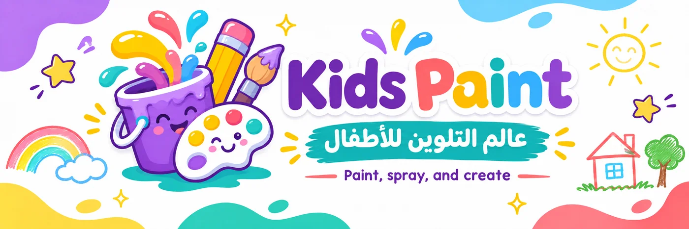
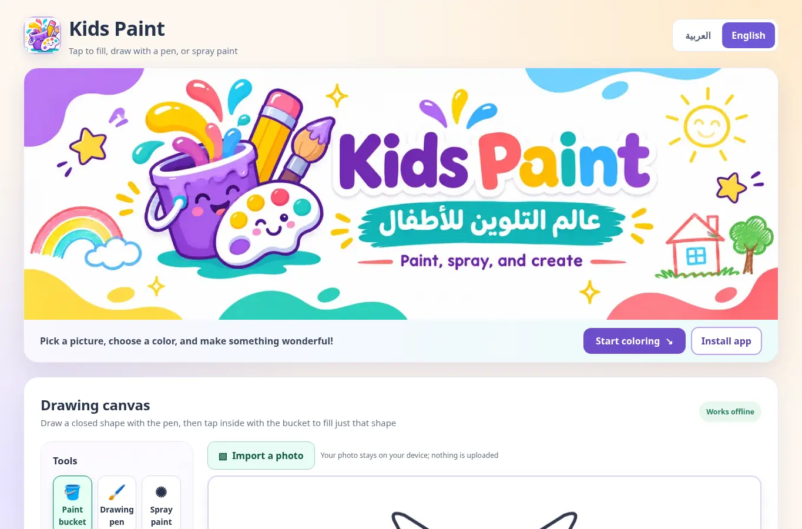
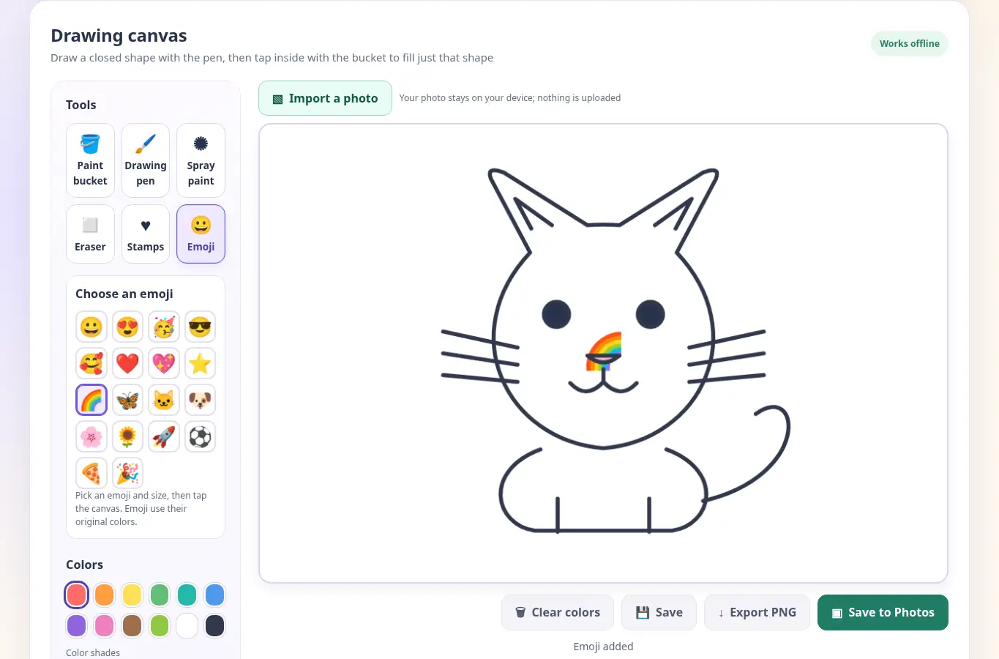
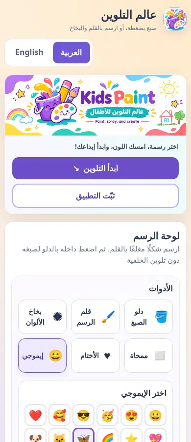

# Kids Paint — عالم التلوين للأطفال

**[English (default)](README.md) · [العربية — اقرأ التوثيق بالعربي](README.ar.md)**

[](LICENSE)


[](https://abinadwan.github.io/kids-paint/)



**Paint, spray, stamp, add emoji, and create.** Kids Paint is a free, open-source, bilingual drawing and coloring web app for kids. It works in modern mobile and desktop browsers, supports adding photos from your gallery, and can be installed on a phone's home screen for offline use after the first successful app-shell download.

**Live app:** https://abinadwan.github.io/kids-paint/

## Screenshots

Actual screenshots of the web interface captured in Chromium (not physical iPhone screenshots):

| Desktop | Emoji editor |
| --- | --- |
|  |  |

**Mobile interface**



## What's new in v4.2

- **Emoji stickers:** 18 native emoji (faces, hearts, rainbow, butterfly, animals, flowers, rocket, ball, food, celebration). Choose **Emoji**, select a symbol and set its size, then tap the canvas or imported picture. Emoji retain their native multicolor appearance, unlike the color-customizable vector stamps. Undo/redo, clear, local save, and PNG export all include emoji.
- **Save to Photos / gallery handoff:** a new **Save to Photos** button prepares a PNG and opens the native **Share** sheet when file sharing is available. **On iPhone, select “Save Image” from the share sheet** to place the image in Photos; a website cannot silently add photos to the library. On Android, choose a supported Photos/gallery app or save destination. If sharing files is unavailable, the app **downloads the PNG**; open the downloaded file and save/share it into Photos manually. This is separate from the editable **Save** button.
- **Documentation:** expanded English README, separate linked Arabic translation, and screenshots.
- **Offline cache bump:** updates the PWA app shell to version `v4.2.0` so installed users receive the new tools and styles once they reconnect.

## Features

| Feature | Details |
| --- | --- |
| Drawing pen | Smooth pointer drawing with adjustable size; closed shapes can become paint-bucket boundaries |
| Spray paint | Semi-transparent scattered dots, touch or drag |
| Paint bucket | Fills areas in 13 provided line-art pictures, closed hand-drawn shapes, and optionally the outside background of ordinary templates; won't flood imported photos |
| Eraser | Removes user-applied paint, marks, stamps, and emoji without erasing an imported photo or original template |
| Vector stamps | Six recolorable shapes: heart, star, butterfly, flower, crescent moon, smiley face |
| Emoji tool | 18 OS-rendered emoji stickers placed at adjustable size; their intrinsic colors are not changed by the palette |
| Colors | 12 color families, five shades per family, plus a custom color input (for pen/spray/bucket/vector stamps) |
| Gallery photo import | Import a browser-supported image (e.g. JPG, PNG, WebP) from your device, draw or place emoji/stamps over it; file size limit 30 MB |
| Picture templates | 13 built-in vector illustrations plus one blank canvas (14 choices total) |
| Undo / Redo | Up to 22 drawing states, including user pen boundaries and emoji/stamps |
| Save / Open / Delete | Editable drawings saved locally in IndexedDB, with localStorage fallback; not synced or cloud-backed |
| Export PNG | Download a flattened 960 × 640 PNG containing the photo/background, template, and all additions |
| Save to Photos | Native file Share sheet where supported; otherwise download and manually save the PNG to your gallery |
| Language | Arabic and English, including RTL/LTR switch and retained preference when storage is available |
| PWA | Installable app shell, icons, manifest, offline cache of essential static assets, standalone display |

## Get started

Open [the live website](https://abinadwan.github.io/kids-paint/). Choose an illustration or **Free Draw**, select a tool and size, and start creating. You can choose a color family, then a shade, or use **Custom color**. The **Emoji** tool uses the symbol's built-in colors.

To import a photo, select **Import a photo**, pick an image from the phone's gallery/files, and use the pen, spray, stamps, or emoji on top. Your original photo stays on a separate non-destructive background layer. It is resized to fit a fixed 960 × 640 canvas without cropping; letterboxing may appear for different aspect ratios. Large files over 30 MB are refused; HEIC/HEIF support depends on the browser.

**Bucket caution:** on an imported photo, fill is restricted to **closed pen-drawn regions** to prevent painting over the entire photograph. On templates or the blank page, tapping outside a closed boundary may color the outer background. Emoji and spray dots are not intended to form fill boundaries.

## Install as a mobile app and use offline

**iPhone (Safari):** open the live link, tap **Share → Add to Home Screen**, enable **Open as Web App** when displayed, and tap **Add**. Launch it once while online. iOS may isolate the installed app's storage from Safari: save/export important artwork before switching contexts or clearing website data.

**Android (Chrome):** open the live link, choose **Install app** or **Add to Home Screen** from the browser menu, or follow the **Install app** instructions within Kids Paint. Open the installed app once while connected.

The Service Worker caches the HTML, CSS, JavaScript, banner, manifest, and icons inside the `/kids-paint/` GitHub Pages scope; after the initial cache succeeds, the drawing editor can launch offline. **Your saved drawings are stored in browser storage, not in the Service Worker cache or GitHub.** Browser storage can be deleted or evicted, so export important artwork to PNG. Updates load when online; an installed device may need a restart/reload after an update.

## Save, export, and Photos — what's the difference?

- **Save:** keeps an *editable project* on this device and inside this particular browser/app storage profile. Photos included in projects may be re-encoded/resized for storage. The app does not create an online account or upload artwork.
- **Export PNG:** downloads a finished *flat image*. Where the file goes depends on your browser/OS (often **Downloads** or **Files**).
- **Save to Photos:** when the browser supports sharing files, opens the system share sheet; **you must choose Save Image / Photos yourself**. Otherwise PNG download is used and you can move the file to Photos manually. No browser API guarantees direct, automatic insertion into iOS Photos.

## Privacy, accessibility, and limitations

- **Local-first:** no backend, accounts, advertising, analytics, user-upload endpoint, runtime CDN scripts, or cloud synchronization. Imported images are handled on-device; artwork is not transmitted to a server by the app. Choosing an external share destination is an explicit user action.
- **Accessibility:** descriptive labels, pressed-state feedback, large touch targets, keyboard-focus styling, and Arabic RTL/English LTR UI. Painting is primarily a pointer/touch interaction.
- **Storage:** IndexedDB is preferred; localStorage fallback may run out of space. Separate Safari/PWA browser profiles might not share artwork. Deleted browser data can delete saved projects.
- **Emoji appearance:** depends on the OS and installed fonts; not all platforms render emoji identically. Color selection applies to vector stamps, not native emoji glyphs.
- **Drawing limits:** canvas is 960 × 640; bucket fill needs properly closed pen lines; photos are fitted into this fixed frame. Hardware-device support and actual iOS share-sheet/gallery behavior should be verified on a real phone.

## Files

| File / folder | Role |
| --- | --- |
| `index.html` | Bilingual layout, tool buttons, file input, art canvas, gallery and installation guidance |
| `style.css` | Responsive layout, drawing tools, emoji panel, buttons, footer |
| `drawing.js` | All drawing, stamps/emoji, share/export, image import, translations and local data |
| `pwa.js` | Installation prompt and in-app instructions |
| `sw.js` | Offline Service Worker; precaches required app assets |
| `manifest.webmanifest` | App name, scope, display mode, icon references |
| `assets/` | Approved banner, website/app icons, PWA icons |
| `docs/screenshots/` | Browser screenshots for this README |
| `README.ar.md` | Full Arabic documentation |
| `PARENTING_KIDS_PAINT.md` | Parent-facing guide |
| `QA_REPORT.md` | Test coverage and limitations |
| `tests/` | Chromium/Playwright and Service Worker regression tests |
| `LICENSE` | MIT open-source license |

## Local development and tests

No build system, Node package installation, framework, external API, or backend is needed to run the app. Serve this folder via a local HTTPS-enabled/static server to test PWA installation (Service Workers require a secure context; `localhost` is normally treated as secure). For a basic non-PWA preview, open `index.html` directly in a browser. A `file://` page will generally not register its Service Worker.

Regression tests (when Python, Playwright, Pillow, Chromium, and Node.js are available):

```bash
python tests/smoke_test.py
python tests/user_outline_test.py
python tests/photo_stamps_test.py
python tests/emoji_gallery_test.py
python tests/install_ui_test.py
node tests/service_worker_unit.js
```

Some tests use an in-memory browser page and mocked localStorage; they do **not** prove device-specific iOS photo-library behavior. See [QA_REPORT.md](QA_REPORT.md).

## License and contribution

Copyright © 2026 **abinadwan**. Licensed under the [MIT License](LICENSE), which permits use, modification, and distribution (including commercially) provided the license and copyright notice are retained. See the [GitHub repository](https://github.com/abinadwan/kids-paint) for source, issues, and contributions.

**[Read the complete Arabic README →](README.ar.md)**
